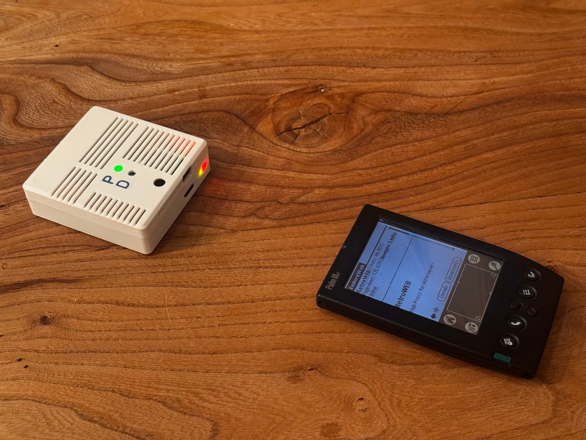
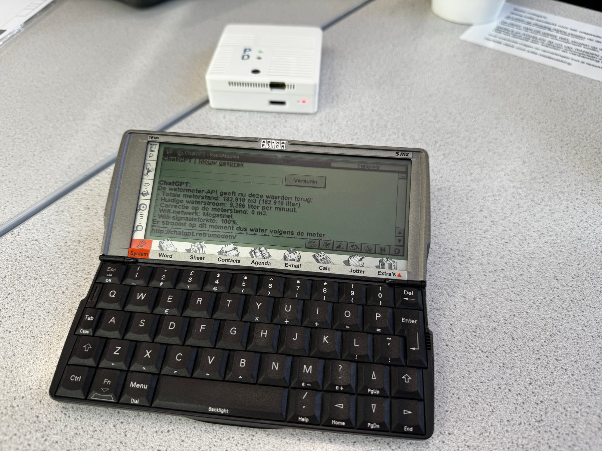
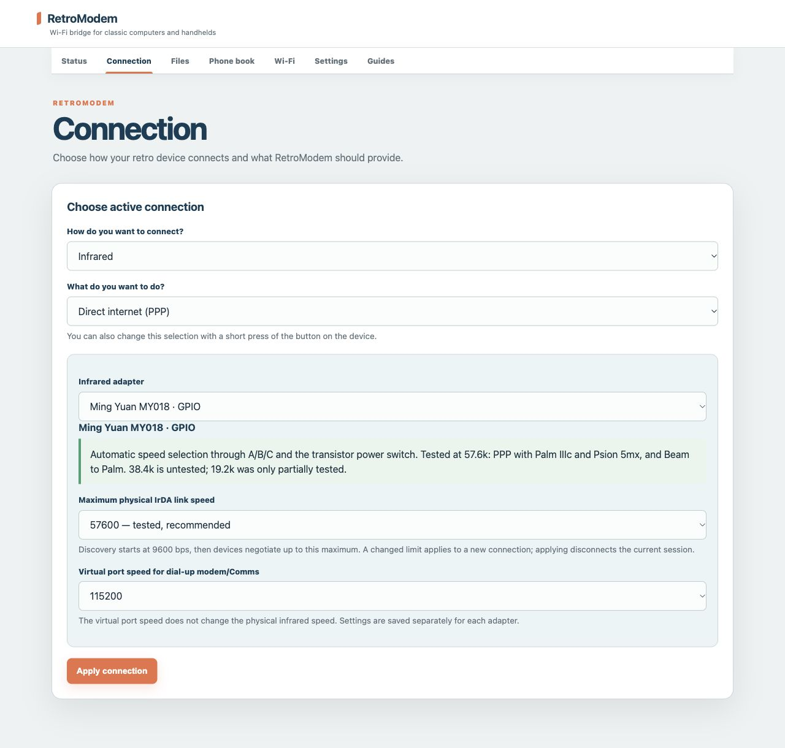
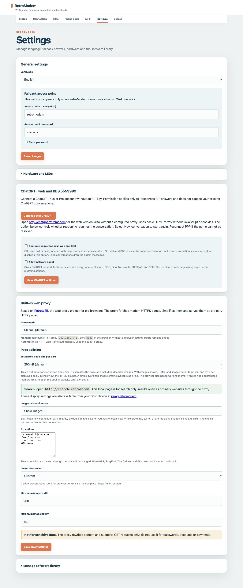

# RetroModem

**A Raspberry Pi internet bridge, virtual modem and modern-web gateway for
vintage computers and handhelds.**

> **First public release.** The installer has completed a clean-SD installation
> and `retromodem-verify` reported zero errors. Raspberry Pi 3 Model B is the
> supported Pi model for this release.



*The current infrared RetroModem prototype with a Palm IIIc.*

RetroModem gives devices such as a Psion 5mx, Palm IIIc, Windows 98/XP PC and
classic Macintosh a route to the internet without requiring another computer
as a gateway. It supports direct PPP, a Hayes-compatible dial-up modem, public
BBS connections, file transfer and a web interface designed for both modern
and very old browsers.

The preferred build uses a Ming Yuan MY018 infrared module on the Pi GPIO/UART.
A Prolific USB-to-RS-232 adapter provides the main wired path, while a Mobile
Action MA-620 remains available as a USB infrared fallback.

## Install

Flash **Raspberry Pi OS Legacy Bookworm (32-bit) Lite** with Raspberry Pi
Imager, enable SSH and boot the Pi. Then run this command in its SSH session:

```sh
curl -fsSL https://raw.githubusercontent.com/BjornB2/retromodem/main/bootstrap.sh | sh
```

The guided installer asks which connection hardware to configure. Do not
download the automatically generated GitHub source archives as an installation
package; the bootstrap command above is the supported installation method. See
the [complete installation guide](docs/INSTALL.md) before connecting or powering
an MY018 module.

## What it can do

- direct PPP over infrared or RS-232;
- Hayes commands and dial-up internet through `ATDT5559000`;
- a configurable phone book for public BBS systems;
- ChatGPT through a small HTML interface or the local BBS number `5559999`;
- Search and simplified modern web pages on legacy browsers;
- built-in RetroWEB proxy with image conversion, resizing and pagination;
- Wi-Fi setup directly from the connected retro device;
- X/Y/ZMODEM terminal file transfer, including verified YMODEM transfers with
  the built-in **Comms** application on a Psion 5mx;
- Palm IrOBEX sending and experimental Psion EikonIr support;
- a mode/shutdown button and status LEDs for headless use.

### A phone book for the post-dial-up internet

Most surviving BBS systems are now offered through Telnet rather than a real
telephone line. RetroModem's phone book maps each BBS hostname and TCP port to
a virtual telephone number. A vintage computer can therefore use its original
terminal software and issue a familiar command such as `ATDT5551000`.
RetroModem answers the virtual call and translates it into the corresponding
Telnet connection, allowing the old device to genuinely dial into a BBS again
without a landline, modem bank or public telephone network.



*The lightweight ChatGPT interface running on a Psion 5mx over infrared.*

Once connected, the retro device can open:

| Address | Purpose |
| --- | --- |
| `http://start.retromodem/` | Search, ChatGPT and settings links |
| `http://setup.retromodem/` | Retro-client configuration |
| `http://wifi.retromodem/` | Wi-Fi status, scanning and connection |
| `http://proxy.retromodem/` | Proxy routing, page and image settings |

From a modern computer, tablet or phone on the same network, open
`http://retromodem.local/` for the full administration interface. This interface
is intended for remote management and is not the retro-device page.

For day-to-day use, print or save the
[one-page RetroModem quick reference (PDF)](docs/RetroModem-Quick-Reference.pdf).
It collects the default access details, local URLs, virtual telephone numbers,
network settings and button controls on a single A4 page.

Connection type, adapter and link speeds can be selected without editing
configuration files:



The same interface manages the fallback access point, ChatGPT integration,
RetroWEB behaviour, page splitting and device-specific image sizes:



## The modern web on old hardware

RetroModem includes RetroWEB, a translation layer that fetches modern HTTPS
pages, extracts their useful content and serves compact legacy-compatible HTML.
Images can be shown inline or as links and are resized to reduce memory and
bandwidth use.

The proxy is based on the project described in
[My take on a retro proxy](https://www.bjornsblog.nl/general/my-take-on-a-retro-proxy/).

## Connection options

| Connection | Intended use |
| --- | --- |
| **MY018 GPIO/UART infrared** | Preferred compact infrared build, with modified selector wiring and transistor circuit |
| **Prolific USB-to-RS-232** | Main wired path for computers without infrared; cable/null-modem requirements depend on the computer |
| **MA-620 USB infrared** | Fallback USB infrared adapter |

An RS-232 adapter is electrically different from a USB-TTL lead. Use the
correct adapter and cable for the target computer.

## Tested hardware and clients

- Raspberry Pi 3 Model B Rev 1.2;
- modified MY018 at 57.6 kbit/s and MA-620 fallback at 9600 bit/s;
- Psion 5mx direct PPP and Hayes/BBS sessions;
- Palm IIIc direct PPP and Palm Beam receiving over IrOBEX;
- Windows XP dial-up internet and BBS over infrared;
- Windows 98 dial-up BBS;
- Prolific USB-to-RS-232 for wired PPP and Hayes/BBS.

See the [protocol evidence and support matrix](docs/PROTOCOL-AUDIT.md) for
implementation details and known limits.

## Documentation

- [Hardware, GPIO wiring, power and enclosure](docs/HARDWARE.md)
- [MY018 modification, speed control and limitations](docs/MY018-SETUP.md)
- [Install RetroModem](docs/INSTALL.md)
- [Configure a Psion 5mx or Palm](docs/CLIENT-SETUP.md)
- [Clean-install verification](docs/CLEAN-INSTALL-ACCEPTANCE.md)
- [Quick reference](docs/QUICKSTART.md)
- [Printable one-page quick reference (PDF)](docs/RetroModem-Quick-Reference.pdf)

## Project status

The web interface, access-point fallback, PPP and Hayes backends, phone book,
ChatGPT BBS and RetroWEB integration are operational. The installer pins its
external sources and preserves the SSH account created in Raspberry Pi Imager.
Installation uses Raspberry Pi OS rather than a downloadable prebuilt SD-card
image.

The printable [enclosure files](hardware/enclosure/README.md) are included as a
rough prototype. Space is provided for the MY018, but the dimensions are not
quite right; hot glue is the pragmatic mounting solution.

## Background

RetroModem grew from the Raspberry Pi PPP setup documented in
[How to connect your Psion or Palm PDA to the internet](https://www.bjornsblog.nl/general/how-to-connect-your-psion-to-the-internet-in-2024/).
The current project expands that idea into a managed appliance with infrared,
dial-up emulation, a phone book, device-side Wi-Fi setup and a legacy web
gateway.

## License

GPL-3.0-or-later.
