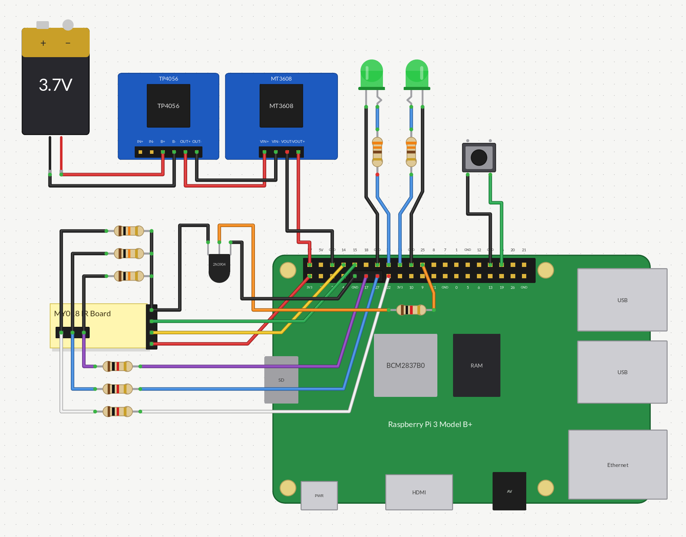
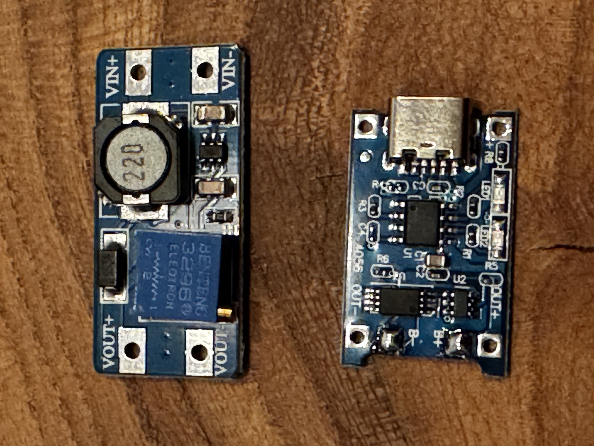
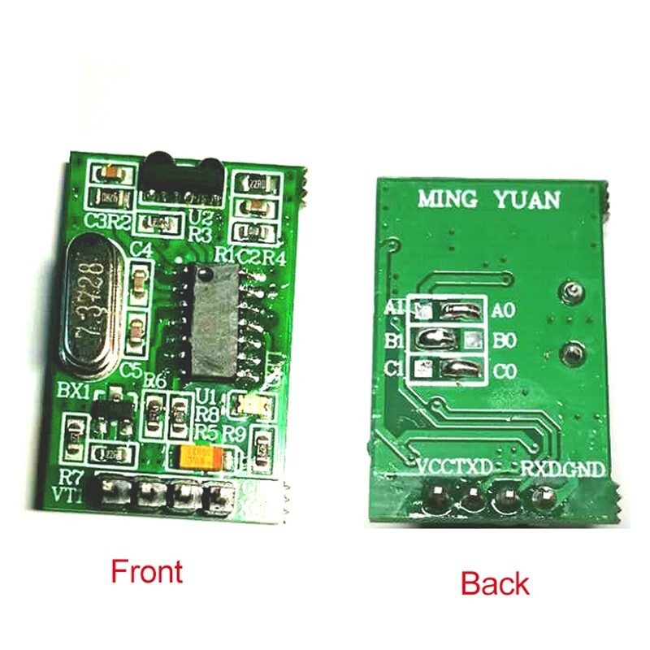

# Hardware and wiring

RetroModem was built and tested on a Raspberry Pi 3 Model B. The preferred
infrared interface is a modified Ming Yuan MY018 module. A Prolific
USB-to-RS-232 adapter is the main wired alternative, and a Mobile Action MA-620
is supported as a USB infrared fallback.

## MY018 prototype wiring

The drawing below is a practical assembly overview rather than a formal
electronic schematic. The MY018 is represented by a stand-in block: its four
side connections are **GND, RXD, TXD and VCC** from top to bottom, and the three
selector pads are **A, B and C**.

| Part or connection | Physical Pi pin | Function / BCM |
| --- | ---: | --- |
| MY018 VCC | 1 | 3.3 V |
| MY018 TXD | 8 | BCM14 / Pi TX; the tested board uses host-perspective labels, so do not cross TXD and RXD |
| MY018 RXD | 10 | BCM15 / Pi RX |
| MY018 A centre pad | 11 | BCM17, through 1 kΩ |
| MY018 B centre pad | 13 | BCM27, through 1 kΩ |
| MY018 C centre pad | 15 | BCM22, through 1 kΩ |
| 2N3904 base | 22 | BCM25, through 1 kΩ |
| 2N3904 emitter | 6 | Pi GND |
| 2N3904 collector | — | MY018 board GND |
| Dial-up/status LED | 16 | BCM23, through 330 Ω; cathode to GND pin 14 |
| PPP/status LED | 18 | BCM24, through 330 Ω; cathode to GND pin 20 |
| Mode/shutdown button | 36 | BCM16; other side to GND pin 34 |
| Raspberry Pi power | 2 and 9 | 5 V and GND from the adjusted MT3608 output |

Important modification details:

- remove the original A/B/C solder bridges;
- connect each A/B/C centre pad to its GPIO through a separate 1 kΩ resistor;
- add a separate 10 kΩ pull-down from each centre pad to **board GND**;
- switch board GND through the documented 2N3904 circuit; do not add another
  direct board-GND-to-Pi-GND connection;
- adjust the MT3608 output to a measured **5.0 V before connecting the Pi**.

Read the complete [MY018 setup guide](MY018-SETUP.md) before modifying or
connecting the module. Disconnect USB and the battery while changing wiring.

## Power boards

The upper board is the adjustable **MT3608 step-up converter**. Its input comes
from the TP4056 output; its measured 5.0 V output connects to physical Pi pins
2 and 9. The lower board is the USB-C **TP4056 charger/protection board** for a
single 18650 cell. The cell connects to B+ and B−, while protected OUT+ and OUT−
feed the MT3608. Board variants exist, so follow the markings on your actual
boards rather than their position in the photograph.

This battery arrangement is a hand-built prototype, not a certified power
supply. Use an appropriate protected cell, insulate all exposed connections
and do not charge the device unattended.

## MY018 board

The rear silkscreen identifies VCC, TXD, RXD and GND; the front shows the A/B/C
solder bridges. Compare these markings with your own module before modifying
it. Image source: [MY018 product listing](https://www.ebay.com/itm/306204181304).

## Prototype enclosure

Printable [bottom and lid STL files](../hardware/enclosure/README.md) are
included. They are a rough prototype built around the current hand-wired
assembly. Space is provided for the MY018, but its dimensions are not quite
right; hot glue is the pragmatic mounting solution. Check all clearances before
printing or powering the device.
